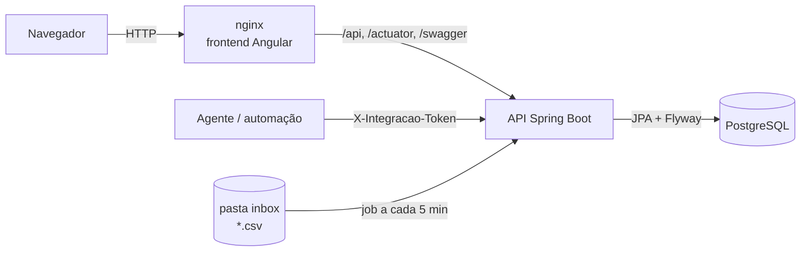

# Candidaturas

[](https://github.com/josevaldojunior/candidaturas/actions/workflows/backend.yml)
[](https://github.com/josevaldojunior/candidaturas/actions/workflows/frontend.yml)
[](LICENSE)

Sistema web para organizar a busca de emprego: registre candidaturas, acompanhe cada uma por um pipeline de
etapas, receba lembretes de follow-up e veja no dashboard onde o processo trava. Cada pessoa tem a própria conta,
e as candidaturas podem ser cadastradas à mão, importadas por CSV ou enviadas por um **agente/automação** pela API.

| Camada | Tecnologias |
|---|---|
| Backend | Java 21, Spring Boot 3 (Web, Data JPA, Validation, Security, OAuth2 Resource Server, Actuator), Flyway, springdoc-openapi, Commons CSV |
| Banco | PostgreSQL 16 · H2 em arquivo no perfil `dev` · H2 em memória nos testes |
| Frontend | Angular 18 (standalone, signals), Angular Material 3, CDK drag-drop |
| Infra | Docker Compose, nginx, GitHub Actions |

## Funcionalidades

- **Contas**: cadastro e login (JWT). Cada conta enxerga só os próprios dados.
- **Candidaturas**: CRUD com filtros (status, empresa, plataforma, stack, prioridade, período, pendências e busca por texto). Os filtros ficam na URL, então voltar do detalhe mantém a lista como estava.
- **Pipeline de status**: `INTERESSE → CANDIDATADO → TRIAGEM_RH → TESTE_TECNICO → ENTREVISTA_TECNICA → ENTREVISTA_FINAL → PROPOSTA → ACEITA | RECUSADA | SEM_RETORNO`. Toda mudança vai para o histórico e gera uma interação.
- **Quadro (Kanban)**: arraste o cartão para mudar o status. No celular, rolagem horizontal e arraste com toque longo.
- **Dashboard**: total, em andamento, pendências, taxa de resposta, funil por etapa, candidaturas por plataforma e por semana. Também há visualização em tabela.
  - *Taxa de resposta* = candidaturas enviadas que chegaram pelo menos à triagem ou foram recusadas, dividido pelas enviadas.
  - *Funil*: quantas candidaturas alcançaram cada etapa, considerando o histórico.
- **Interações e follow-ups**: registro de e-mails, ligações e entrevistas, com data de follow-up. Uma tela lista os vencidos e os dos próximos 7 dias.
- **Sem retorno automático**: candidaturas paradas há mais de X dias (padrão 30, ajustável por conta) viram `SEM_RETORNO` num job diário às 18:00 ou pelo botão "Executar agora".
- **Pendências**: anote o que falta fazer numa candidatura (selo "Pendente", filtro e contador). Ao sair de *Interesse*, a pendência é concluída automaticamente e fica no histórico.
- **Contatos**: recrutadores, tech leads e gestores, vinculados às candidaturas.
- **CSV**: exportação (com os filtros da lista) e importação no mesmo formato, sem duplicar.
- **Integração para agentes**: API de upsert com token por conta, além de uma pasta `inbox` lida a cada 5 minutos.
- **Tema claro/escuro** (automático, claro ou escuro) e layout responsivo com menu hambúrguer no celular.

## Arquitetura



- O frontend é servido pelo nginx, que encaminha `/api`, `/actuator` e o Swagger para a API. Assim o navegador fala com um único endereço.
- A API não guarda sessão: o login devolve um JWT assinado (HS256) e cada requisição o envia em `Authorization: Bearer`.
- Agentes usam um token próprio da conta (`X-Integracao-Token`). No banco fica só o SHA-256 dele.
- Toda consulta filtra pelo dono do registro. Um registro de outra conta responde `404`.

## Como rodar

### Docker Compose (tudo com um comando)

Pré-requisito: Docker.

```bash
cp .env.example .env      # e troque JWT_SEGREDO por um valor aleatório (openssl rand -base64 48)
docker compose up -d --build
```

| Endereço | O que é |
|---|---|
| http://localhost:4200 | Aplicação |
| http://localhost:8080/swagger-ui.html | Documentação da API (botão *Authorize* aceita o login ou o token de integração) |
| http://localhost:8080/actuator/health | Saúde da API |

Abra a aplicação e crie a sua conta. **A primeira conta criada assume os registros que já existiam** antes das contas (útil ao atualizar uma instalação antiga).

Para parar, use `docker compose down`. Para apagar também os dados, use `docker compose down -v`.

### Modo desenvolvimento (sem Docker)

Pré-requisitos: JDK 21, Maven 3.9+ e Node 18.19+ (recomendado 20).

```bash
# terminal 1 – API com H2 em arquivo (./backend/data), sem PostgreSQL
cd backend
mvn spring-boot:run -Dspring-boot.run.profiles=dev
```

```bash
# terminal 2 – frontend em http://localhost:4200, com proxy de /api para a porta 8080
cd frontend
npm install
npm start
```

Sem `JWT_SEGREDO` no modo dev, a API usa uma chave temporária, e os logins expiram quando ela reinicia. O console do H2 fica em http://localhost:8080/h2-console (JDBC URL `jdbc:h2:file:./data/candidaturas`, usuário `sa`).

### Testes

```bash
cd backend && mvn verify      # unitários (JUnit 5 + Mockito) e integração (MockMvc + H2), incluindo segurança
cd frontend && npx ng build   # build de produção
```

## Configuração

Todas as opções vêm de variáveis de ambiente (no Docker Compose, pelo arquivo `.env`):

| Variável | Padrão | Uso |
|---|---|---|
| `JWT_SEGREDO` | — (obrigatório no perfil `prod`) | Segredo que assina os logins. Pelo menos 32 caracteres aleatórios |
| `DB_URL`, `DB_USER`, `DB_PASSWORD` | PostgreSQL local | Conexão com o banco (no Compose só `DB_PASSWORD` é exposto) |
| `CADASTRO_ABERTO` | `true` | `false` permite só a primeira conta, para uso pessoal |
| `SESSAO_HORAS` | `12` | Duração do login |
| `CORS_ORIGENS` | `http://localhost:4200` | Origem(ns) do frontend, separadas por vírgula |
| `INBOX_DIR` | `./inbox` | Pasta de CSVs lida a cada 5 minutos |
| `INBOX_USUARIO` | vazio | E-mail da conta que recebe os CSVs da pasta (vazio desliga a leitura automática) |
| `API_PORTA`, `WEB_PORTA` | `8080`, `4200` | Portas publicadas pelo Compose |

## Hospedagem

O projeto já sai pronto para rodar num servidor (VPS, ou qualquer serviço que rode containers e PostgreSQL):

1. Defina um `JWT_SEGREDO` forte. No perfil `prod`, usado pelo Compose, a API **não sobe** sem ele ou com o valor de exemplo.
2. Coloque um proxy com HTTPS na frente (Caddy, Traefik, nginx com Let's Encrypt, ou o do provedor) apontando para a porta do frontend. A API respeita os cabeçalhos `X-Forwarded-*`.
3. Ajuste `CORS_ORIGENS` para o domínio público. Se o frontend for servido pelo nginx do projeto, o navegador nem chega a fazer chamadas cross-origin.
4. Para uso só seu, crie a conta e depois use `CADASTRO_ABERTO=false`.
5. Num servidor, a porta da API (`API_PORTA`) pode deixar de ser publicada: o frontend já encaminha `/api`. Agentes externos podem chamar `https://seu-dominio/api/...`.
6. Faça backup do volume do PostgreSQL (`pg_dump`).

## Integração com agentes e automações

Qualquer agente, script ou automação pode registrar candidaturas numa conta:

1. Em **Configurações → Integração**, gere o token da conta. Ele aparece uma única vez; gerar outro invalida o anterior.
2. Envie o token no header `X-Integracao-Token`. Os dados vão sempre para a conta dona do token.

### `POST /api/integracao/candidaturas`

Recebe um **array JSON** (um objeto sozinho também é aceito). Para criar uma candidatura, `empresa` e `cargo` são obrigatórios.

```json
[
  {
    "chaveExterna": "linkedin-4012345678",
    "empresa": "ACME Tecnologia",
    "cargo": "Desenvolvedor Java Pleno",
    "linkVaga": "https://www.linkedin.com/jobs/view/4012345678",
    "plataforma": "LinkedIn Vagas",
    "modalidade": "Remoto",
    "tipoContrato": "PJ",
    "faixaSalarial": "R$ 10.000 – 13.000",
    "pretensaoSalarial": "R$ 12.000",
    "nota": 8,
    "dataCandidatura": "2026-10-24",
    "status": "Candidatado",
    "prioridade": "Alta",
    "curriculoVersao": "v3-backend",
    "observacoes": "Vaga 100% remota",
    "stack": ["Java", "Spring Boot", "Kafka"],
    "contatoNome": "Ana Souza",
    "contatoEmail": "ana.souza@acme.com",
    "contatoTelefone": "(11) 99999-0000",
    "tipoInteracao": "e-mail",
    "descricaoInteracao": "Candidatura enviada pelo LinkedIn",
    "proximoPasso": "Cobrar retorno",
    "dataFollowUp": "2026-10-31"
  }
]
```

Regras:

- **Upsert**: a chave é `chaveExterna` ou, se vier vazia, `linkVaga`. Sem nenhuma das duas, a busca é por empresa + cargo, sem diferenciar maiúsculas. Ao atualizar, só os campos enviados mudam, e uma mudança de status vai para o histórico. Uma candidatura nova entra com origem `AGENTE` e status padrão `CANDIDATADO`.
- **Texto livre nos campos de opção**: a comparação ignora acento, caixa, espaço e hífen (`"Híbrido"`→`HIBRIDO`, `"Triagem RH"`→`TRIAGEM_RH`, `"e-mail"`→`EMAIL`). Tipo de contrato e tipo de interação desconhecidos viram `OUTRO`. Status, modalidade ou prioridade inválidos geram erro naquele item.
- **Plataformas**: `LINKEDIN_VAGAS`, `LINKEDIN_FEED`, `GUPY`, `INDEED`, `PROGRAMATHOR`, `REMOTAR`, `INFOJOBS`, `GITHUB` (repositórios de vagas no GitHub), `COODESH`, `GEEKHUNTER`, `CATHO` e `OUTRO`. Variações também são reconhecidas: textos com "LinkedIn" viram LinkedIn Vagas, ou Post do Feed quando falam em post/feed; `"Gupy (personalizada)"` vira Gupy; textos com "GitHub" viram GitHub. O resto (e-mail, WhatsApp, sites próprios) vira `OUTRO`.
- **Contato**: é reaproveitado por e-mail ou telefone; senão, é criado como `RECRUTADOR` e vinculado.
- **Interação**: é criada se vier `descricaoInteracao` ou `dataFollowUp`. Reenviar o mesmo item não a duplica.
- **Pendência**: se `observacoes` começar com `PENDENTE:`, o texto depois do prefixo vira a pendência da candidatura.
- **Um item por transação**: um erro num item não afeta os outros.

Resposta (`ignoradas` = itens que já existiam e não trouxeram mudança):

```json
{ "criadas": 1, "atualizadas": 0, "ignoradas": 0, "erros": ["Item 2: empresa é obrigatória"] }
```

### `GET /api/integracao/candidaturas/existe`

Use `?link=...` (procura por chave externa ou link) ou `?empresa=...&cargo=...`. Responde `{"existe": true|false, "candidatura": {...} | null}`.

### Exemplos

```bash
curl -X POST http://localhost:8080/api/integracao/candidaturas \
  -H "X-Integracao-Token: $TOKEN" \
  -H "Content-Type: application/json; charset=utf-8" \
  --data-binary @candidaturas.json
```

```bash
curl -G http://localhost:8080/api/integracao/candidaturas/existe \
  -H "X-Integracao-Token: $TOKEN" \
  --data-urlencode "link=https://www.linkedin.com/jobs/view/4012345678"
```

```powershell
$corpo = Get-Content .\candidaturas.json -Raw -Encoding UTF8
Invoke-RestMethod -Method Post -Uri http://localhost:8080/api/integracao/candidaturas `
  -Headers @{ 'X-Integracao-Token' = $env:TOKEN } `
  -ContentType 'application/json; charset=utf-8' -Body ([Text.Encoding]::UTF8.GetBytes($corpo))
```

Envie o JSON como arquivo UTF-8 (`--data-binary @arquivo`) para os acentos chegarem corretos.

## Pasta inbox (CSV)

Em instalações próprias, o servidor lê arquivos `*.csv` da pasta `inbox/` a cada **5 minutos** e os importa para a conta de `INBOX_USUARIO`, com a mesma regra de upsert da integração. Cada arquivo é movido:

- para `inbox/processados/` se todos os itens entraram;
- para `inbox/erros/` se houve erro, com um `<arquivo>.erros.txt` ao lado (os itens válidos já foram importados).

Os arquivos movidos ganham um prefixo com data e hora. Para processar na hora, use *Configurações → Processar agora* (importa para a conta logada) ou `POST /api/inbox/processar`.

Formato (UTF-8, com ou sem BOM; separador `,` ou `;`), o mesmo da exportação:

```csv
chave_externa,empresa,cargo,link_vaga,plataforma,modalidade,tipo_contrato,faixa_salarial,pretensao_salarial,nota,data_candidatura,status,prioridade,curriculo_versao,stack,observacoes,contato_nome,contato_email,contato_telefone,tipo_interacao,descricao_interacao,proximo_passo,data_follow_up
li-4012345678,ACME Tecnologia,Desenvolvedor Java Pleno,https://www.linkedin.com/jobs/view/4012345678,LinkedIn Vagas,Remoto,PJ,,R$ 12.000,8,24/10/2026,Candidatado,Alta,v3,Java;Spring Boot;Kafka,,Ana Souza,ana.souza@acme.com,,e-mail,Candidatura enviada,Cobrar retorno,2026-10-31
```

`stack` é separada por `;` (entre aspas quando o separador do arquivo também for `;`). As datas podem vir como `yyyy-MM-dd` ou `dd/MM/yyyy`.

## API (resumo)

A lista completa está no Swagger (`/swagger-ui.html`).

| Método | Caminho | Descrição |
|---|---|---|
| POST | `/api/auth/cadastro`, `/api/auth/login` | Cria conta / entra (devolve o JWT) |
| GET | `/api/conta` | Dados da conta logada |
| PUT | `/api/conta/senha` | Troca a senha |
| GET/POST/DELETE | `/api/conta/token-integracao` | Status, geração e revogação do token do agente |
| GET/POST | `/api/candidaturas` | Lista (filtros + paginação) / cria |
| GET/PUT/DELETE | `/api/candidaturas/{id}` | Detalhe / atualiza / exclui |
| PATCH | `/api/candidaturas/{id}/status` | Muda o status (histórico + interação) |
| GET | `/api/candidaturas/kanban` | Candidaturas agrupadas por status |
| POST | `/api/candidaturas/{id}/interacoes` | Registra interação |
| PATCH | `/api/interacoes/{id}/follow-up` | Conclui follow-up |
| GET/POST/PUT/DELETE | `/api/contatos` | Contatos |
| GET | `/api/dashboard` | Indicadores |
| GET | `/api/follow-ups` | Follow-ups vencidos e dos próximos 7 dias |
| GET/PUT | `/api/sem-retorno/configuracao` | Prazo do sem retorno da conta |
| POST | `/api/sem-retorno/executar` | Executa o sem retorno agora |
| GET/POST | `/api/csv/exportar`, `/api/csv/importar` | CSV |
| POST | `/api/inbox/processar` | Processa a pasta inbox agora |
| POST/GET | `/api/integracao/candidaturas`, `/existe` | Integração para agentes |

Os erros seguem um corpo padronizado, inclusive os 401 e 403:

```json
{ "timestamp": "2026-10-24T10:00:00-03:00", "status": 400, "erro": "Bad Request", "mensagem": "Dados inválidos", "caminho": "/api/candidaturas", "campos": [{ "campo": "empresa", "mensagem": "must not be blank" }] }
```

## Estrutura

```
candidaturas/
├─ backend/                 Spring Boot
│  └─ src/main/java/.../    config, domain, repository, dto, service, seguranca, web, util
│  └─ src/main/resources/db/migration   migrations Flyway
├─ frontend/                Angular (core, shared, pages/*)
├─ inbox/                   CSVs para importação automática (processados/ e erros/)
├─ docker-compose.yml       PostgreSQL + API + frontend
└─ .github/workflows/       CI do backend e do frontend
```

## Fluxo de desenvolvimento

- Uma branch por funcionalidade (`feat/...`, `fix/...`, `chore/...`) e Pull Request para a `main`
- Commits no padrão [Conventional Commits](https://www.conventionalcommits.org/pt-br/), em português
- O CI roda `mvn verify` e `ng build` em cada PR

## Licença

[MIT](LICENSE)
